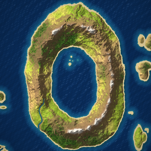

# Overlook

A minimap addon for **WoW Forever** (patch 1.60.1, `## Interface: 16001`) that lets you zoom out past the native minimap's limit and still see your Questie icons, the same ones the big world map shows.

**Requires [Questie](https://www.curseforge.com/wow/addons/questie).** Questie is the source for quest, townsfolk (mailboxes, flight masters, trainers...) and NPC route icons; the game's own tracking icons only exist at native zoom, so Overlook doesn't manage them.

> **Status:** 1.0. Available on CurseForge; see [CHANGELOG.md](CHANGELOG.md).

## Why

I wanted a minimap that could zoom out seamlessly while still working with Questie and all of its quest icons, no matter where I panned. Now I can zoom out, find the next area with quest objectives, and plan my route, then either zoom back in or leave the map zoomed out while I cover the distance. I can even see quest turn-ins from across the continent, right on my minimap.

Existing far-zoom minimaps draw extra terrain around the native minimap, but Questie icons stay stuck inside the native minimap's range, or pile up on its edge. Overlook reads every pin from the shared HereBeDragons registry (where Questie, TomTom and others register their icons) and draws them itself, in the right place, at any zoom out to about one zone.

The full design, with decisions, risks and the test plan, is in [docs/design.md](docs/design.md).

## Features

- Zoom past the native limit, out to about one zone (default 3,000 yards, up to 6,400), smoothly or in steps
- Questie icons at every zoom (kill swords, turn-ins, available quests, townsfolk...) with Questie's own tooltips and clicks
- Questie's NPC patrol routes on the far map
- Other addons' map icons too (RareScanner, TomTom): per-group show, size and shrink-with-zoom
- Party and raid members as class-coloured dots on the far map
- Dungeon and raid entrances on both maps; hover one for its name and level range, coloured for your level
- The game's blue quest areas on the far map, with adjustable opacity, fitted to the round map
- Caves drawn on the far map, every level stacked; Alt + wheel peels them off one by one
- Drag to pan, with a Recenter button; a panned map stays put while you move
- Zooms out when you mount and comes back when you dismount (adjustable)
- Zone name bar above the map and a bottom bar with coordinates, zoom distance and a clock
- Square or round, movable (Alt + drag) and resizable from its corner, with a lock
- Questie's icon switches in our own settings window, plus player arrow size and route line width
- Settings profiles, with export and import strings for sharing
- Settings window, minimap button and addon compartment entry
- Pings drawn on the far map
- Other addons' minimap buttons gathered into a panel on the bottom bar; calendar and addon buttons on the top bar
- Optional rotating minimap at normal zoom, on the round map only (off by default; the far map stays north-up)

Planned: Edit Mode support.

## Roadmap

| Phase | Goal |
| --- | --- |
| 0 | Spike: confirm player position, facing, the HBD registry and terrain tile IDs work on Forever; set up the offline test harness |
| 1 | Core shell and far terrain tiles |
| 2 | Pin mirror: Questie icons, tooltips and clicks on the far map |
| 3 | Rotation and performance budgets |
| 4 | Usability: settings, profiles, button tray, Edit Mode |
| 5 | Extras: round shapes, quest name bubbles, trail path |

## Requirements

- WoW Forever client (1.60.1)
- [Questie](https://github.com/Questie/Questie) (required)

## Installation

Install from CurseForge (the CurseForge app, or download the zip into `_forever_\Interface\AddOns\`). For other ways, see [docs/INSTALL.md](docs/INSTALL.md): download a ZIP, clone with Git, or link a working copy into your Forever client's `Interface/AddOns/` folder.

## Using it

- **Mouse wheel** on the map zooms. Past the native minimap's widest step it keeps zooming out over minimap terrain. **Ctrl + wheel** takes half steps.
- **Drag** the map to pan; **Recenter** (under the map), a **middle-click** or a **double-click** goes back to you. Zooming back in while centred hands over to the native minimap.
- **Right-click** the far map to ping, like a click on the normal minimap. The game only pings within the normal minimap's range.
- **Alt + drag** moves the map; the **corner grip** resizes it.
- **Alt + wheel** in a cave changes level on the far map: it opens with every level stacked, each step down peels off the top level, and past the bottom the whole stack comes back. In a city or dungeon with floors it steps through the floors.
- **`/overlook`** (or **`/ol`**) opens the settings, as do the minimap button (right-click: recenter) and the addon compartment.

| Command | Does |
| --- | --- |
| `/overlook` | Open the settings |
| `/overlook instructions` | The welcome window with every control (also the Instructions button on the settings' Map tab) |
| `/overlook size 250` | Map size in px (120-800) |
| `/overlook maxzoom 3200` | Far-zoom limit in yards (500-6,400) |
| `/overlook smooth` | Toggle smooth zooming |
| `/overlook lock` | Lock or unlock the size |
| `/overlook icons` | List icon groups; e.g. `/overlook icons rarescanner size 0.6` |
| `/overlook reset` | Move the map back to a visible spot at the default size |
| `/overlook gameoptions coord` | The game's own options whose label has that text, their values and CVars |
| `/overlook buttons` | The minimap buttons gathered into the bottom bar's panel |
| `/overlook overrides` | What the bars switched off in other addons and the game (and what it was before) |
| `/overlook areas` | Whether the far view can draw quest areas here, and how many zones it is drawing |
| `/overlook caves` | Which cave the far view would draw here, its levels and the one shown, for checking in game |
| `/overlook underground` | What map the far view would draw here (underground cities, dungeons), for checking in game |
| `/overlook questie` | Check the Questie parts the far map uses (also run once after login; quiet when all is well) |
| `/overlook far`, `/overlook pins`, `/overlook routes` | State, for bug reports |

## Development

- `lua tests/run.lua` runs the offline tests (plain Lua 5.1, no dependencies).
- `luacheck .` lints. CI runs both on every push.
- Releases: see [docs/RELEASING.md](docs/RELEASING.md).

## Licence and credits

MIT: see `LICENSE`.

`Data/MinimapTiles.lua` is OpenMap's tile table and `Data/Entrances.lua` its dungeon entrance table, used under the MIT licence (`LICENSES/OpenMap-LICENSE.txt`).
`Data/Caves.lua` is generated from the game's own files by `tools/map-data/caves.py`, and holds only file IDs and positions, no game art.
