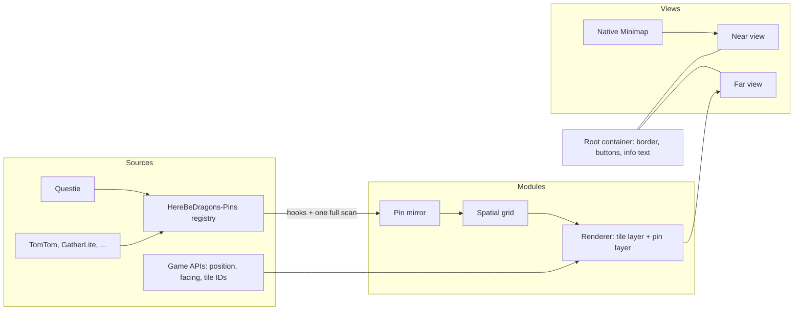

# Far-Zoom Minimap for WoW Forever — Design Doc

Nov 20, 2026 · @Dev Donner

## Summary

**Verdict: plausible, and already proven in part.** Forever Minimap ships a far zoom to 6400 yards drawn from the game's own tiles, with Questie marks carried along ([CurseForge](https://www.curseforge.com/wow/addons/forever-minimap)). So the tile rendering and the pin mirroring both work on this client.

Yes, you can use the big map's data for minimap targets — but not by reading the world map frame. The better source is the **HereBeDragons-Pins registry**. That's the shared library Questie hands every icon to, and it already holds each pin's world coordinates whether or not any map is open.

The hard parts are Questie-specific: its own distance fade, its hidden icons and recycled frames, and the number of spawn icons once you zoom out. Those, not the zoom itself, are what break existing addons.

**Scope (decided Nov 20, 2026):** the goal is Questie working when you zoom out: the same icons the big world map shows, out to about one zone. Continent-scale zoom is not a goal. We build from scratch instead of fixing Forever Minimap, for direct control over every part of the build; Forever Minimap was too buggy in daily use.

## The problem we're solving

In the user's current minimap addon, zooming out shows detailed minimap terrain far past the normal range, which is the look we want to keep. But Questie icons only appear inside a lighter square around the player: the native minimap's own range.

That square is the real `Minimap` frame drawn on top of the extra terrain. Questie hands its icons to HereBeDragons, and HBD only places pins within `C_Minimap.GetViewRadius` of the player, anchored to that frame. Questie sets `floatOnEdge`, so distant objectives pile up on the square's border instead of showing where they are. The extra terrain around it has no pins at all.

The fix is this doc's pin mirror: read HBD's full registry and draw every pin on our own layer, scaled to the far-zoom view, not to the native square. It also settles the tile question: detailed minimap terrain, as in the ToS section.

## Goals and non-goals

Goals:

1. Zoom out continuously past the native minimap's last step, out to about one zone (default max 2,000 yards radius, setting up to 3,200), showing the Questie icons the world map would show for that area, across zone borders too. Continent scale is not a goal.
2. Questie icons (including kill-objective swords) stay drawn individually at every zoom (no merging by default), correctly placed, showing only the source addon's own tooltip.
3. Smooth: no stutter while moving or zooming, and no per-frame cost that grows with pin count.
4. Look like Forever Minimap: square or rounded, draggable, clean frame.
5. **Rotation is a setting** (off by default). Fixed mode gets the fastest rendering path; rotating mode accepts a per-frame cost (see Performance).

Non-goals for v1:

- Far zoom inside instances and buildings (native minimap only there).
- Replacing Questie's quest logic. We draw what Questie decides to draw.

## Features from popular minimap addons

The most common feature across popular minimap addons is a button tray. After that come shape and size, and then auto-zoom. Plan: v1 = ships with the far-zoom core; v2 = after Phase 4.

| Feature | Seen in | Plan |
| --- | --- | --- |
| Addon-button tray behind one button (or a bar/grid) | [MinimapButtonButton](https://www.curseforge.com/wow/addons/minimapbuttonbutton), [Forever Minimap](https://www.curseforge.com/projects/1787717), [NytheraMinimap](https://www.curseforge.com/wow/addons/nytheraminimap), [PeaversMiniMap](https://www.curseforge.com/wow/addons/peaversminimap) | v1, off if a tray addon is already loaded |
| Show buttons only on hover | [SexyMap](https://www.curseforge.com/wow/addons/sexymap), Leatrix Plus, Neat Minimap (per MinimapButtonButton) | v1 |
| Move, scale, borders, square or round shape | [SexyMap](https://github-redirect.dependabot.com/dixon/WorldOfWarcraft_SexyMap), [SenMinimap](https://www.curseforge.com/wow/addons/senminimap), [MidnightMap](https://www.curseforge.com/wow/addons/midnightmap) | v1 (square first; round needs tile masks) |
| Zone text and clock styling; hide header pieces one by one | SexyMap, [MinimapHeaderHider](https://www.curseforge.com/wow/addons/minimapheaderhider) | v1 |
| Coordinates, right-click to copy | [LoqiMinimap](https://www.curseforge.com/wow/addons/loqiminimap) | v1 (addons can't write the clipboard: "copy" shows the text selected in a box for Ctrl+C) |
| Auto-zoom out when mounted, back in on dismount | [LoqiMinimap](https://www.curseforge.com/wow/addons/loqiminimap) ([MidnightMap](https://www.curseforge.com/wow/addons/midnightmap) also auto-zooms; its trigger isn't stated) | v1, and it pairs well with far zoom |
| Class-coloured border | MidnightMap | v2 |
| Separate size for Questie pins; far-map icon size 50–200% | [Minimap Button Scaler](https://www.curseforge.com/wow/addons/minimapbuttonscaler), Forever Minimap | v1 (icon scale per source addon) |
| Quest name bubbles under far-map marks; tracking-menu services on the far map | [Forever Minimap](https://www.curseforge.com/wow/addons/forever-minimap) | v2 |
| Target and Focus back in the tracking menu | [Forever Minimap Target](https://www.curseforge.com/wow/addons/forever-minimap-target) | v2 (small; native zoom only) |
| Farming HUD: big transparent overlay that keeps blips | [FarmHud](https://www.curseforge.com/wow/addons/farmhud), [ForeverFarmHUD](https://www.curseforge.com/wow/addons/foreverfarmhud) | Out of scope: blips can't be copied, so it must reuse the native minimap |
| Trail of your path | FarmHud TrailPath | v2, drawn on our pin layer |

## Usability: size, position and settings

The first draft said "draggable" and nothing more: no resize, no lock, no settings design. This section fills that in without touching the far-zoom core.

**Mouse model (one gesture, one job):**

| Gesture | Does | Why |
| --- | --- | --- |
| Mouse wheel | Zoom; past the native limit it goes on into far zoom | The core feature, no mode switch |
| Ctrl + wheel | Fine zoom (half steps) | Precise framing when zoomed out |
| Drag on the map | Pan to look around; snaps back to the player after 5 s idle (setting) | Forever Minimap users expect drag-to-look |
| Alt + drag, or drag the border | Move the whole minimap | Keeps panning and moving apart |
| Drag the corner grip | Resize; Shift keeps it square | Direct, no menu needed |
| Middle-click or double-click | Recentre on the player and reset to the default zoom | One-click way back |
| Right-click the tray button | Open settings | Settings one click away |

**Known bug, deferred (#24):** in near mode the native `Minimap` owns the mouse, and a left click on it pings your location to the party. Drags, Alt+drag and double-clicks that start on the native map can send that ping too. It's a real bug, scheduled for Phase 4 once the core works.

**Size and position:**

- **Size vs scale are separate.** *Size* (120–600 px, `Minimap:SetSize`) shows more map. *Scale* (50–200%) makes everything bigger, borders and text included. Both are on the grip and in settings.
- **Lock** toggle (default locked after first placement) so a stray drag can't move it. Alt + drag still works when locked.
- **Edit Mode integration** via [LibEditMode](https://www.curseforge.com/wow/addons/libeditmode), so the minimap moves and snaps alongside Blizzard's frames. Forever runs the same Edit Mode internals as retail ([Edit Mode Guide Lines](https://www.curseforge.com/wow/addons/edit-mode-guide-lines) is built on that). Blizzard's own minimap Edit Mode entry should be hidden so there aren't two, but only if that doesn't taint Edit Mode (see Risks); otherwise leave it in place. Edit Mode integration is a setting.
- **No moving or resizing in combat:** queue the change until `PLAYER_REGEN_ENABLED`. This is a safety default until Phase 1 confirms the minimap frame isn't protected.
- **After a resize**, call `HBDPins:SetMinimapObject(Minimap)` once on drag end. It forces a full HBD update so native-zoom pins re-measure the new size. Test in Phase 4 (resize grip) that it's needed and not too slow.
- **Reset position** button, plus `/fzm reset`.

**Settings page:** registered with Blizzard's Settings API (`Settings.RegisterVerticalLayoutCategory` + subcategories), so it lives under Options → AddOns like other Forever addons ([Settings API](https://warcraft.wiki.gg/wiki/Settings_API); Forever addons such as [Gaar Forever](https://www.curseforge.com/wow/addons/gaarmapsforever) use that page). Every change previews live; each page has a "Reset this page" button.

| Page | Settings |
| --- | --- |
| General | Lock, size, scale, shape (square / rounded / round), border style and colour, reset position |
| Zoom | Max far-zoom distance (default 2,000 yd, up to 3,200), wheel step, smooth zoom on/off, snap-back delay, mount auto-zoom (distance, on/off) |
| Rotation | Rotate minimap on/off, update rate (15 / 30 Hz) |
| Map pins | One row per detected source (Questie, TomTom, GatherLite…) with on/off and icon scale; clustering (off by default) and threshold; quest name bubbles; fade icons near the player |
| Buttons and info | Button tray on/off, show buttons on hover, coordinates (and copy), clock, zone text, which header pieces to hide |
| Profiles | Account-wide or per character, copy from another character, import/export string, reset everything |

Other touches: `/fzm` opens settings; a one-time hint on first login ("Scroll to zoom, drag to look, Alt-drag to move"); keybinds for zoom in, zoom out and recentre through `Bindings.xml`.

## Platform facts

| Fact | Why it matters | Source |
| --- | --- | --- |
| Forever is patch 1.60.1, TOC `## Interface: 16001`, project `WOW_PROJECT_CAMELOT` | Our .toc must list 16001; Classic Era code won't load | [Warcraft Wiki](https://warcraft.wiki.gg/wiki/Patch_1.60.1/API_changes), [Warlords Forever](https://www.curseforge.com/wow/addons/warlords-forever) |
| Forever shares Mainline's UI architecture and most 12.1.5 APIs, including Midnight's secret-value restrictions | We get modern `C_Map`, `C_Minimap`, mask textures, `SetClipsChildren`; some data may be restricted | [API notes](https://warcraft.wiki.gg/wiki/Patch_1.60.1/API_changes/notes) |
| Questie ships a `Questie_Forever.toc` (`## Interface: 16001`; checked in the installed 12.11.1) | Questie runs on Forever and uses its normal map code | [Questie repo](https://github.com/Questie/Questie) |
| **Questie 12.x keeps a private, modified copy of HereBeDragons-Pins** as a Questie module (`QuestieLoader:ImportModule("HBDPins")`), not the shared LibStub library. Same tables (`minimapPins`, `minimapPinRegistry`, `worldmapPins`) | `LibStub("HereBeDragons-Pins-2.0")` never sees Questie's icons. The mirror reads two registries: Questie's private one and the shared one (TomTom, RareScanner) (#34) | Installed Questie, `Libs/HereBeDragons/HereBeDragons-Pins-2.0.lua` |
| Questie makes two frames per spawn, `iconMap` and `iconMinimap`, and registers them via `HBDPins:AddWorldMapIconMap` / `AddMinimapIconMap` with `floatOnEdge = true` | Every Questie pin passes through HereBeDragons, which we can read | [QuestieMap.lua](https://github.com/Questie/Questie/blob/master/Modules/Map/QuestieMap.lua) |
| Questie fades minimap icons by distance and hides some with `FakeHide()` | A mirror that copies Questie's alpha will show nothing far away | QuestieMap.lua |
| HBD keeps `pins.minimapPins[icon] = {instanceID, x, y, uiMapID, floatOnEdge, ...}` in world coordinates | The full pin list, independent of any open map | [HereBeDragons-Pins-2.0.lua](https://github.com/Nevcairiel/HereBeDragons/blob/master/HereBeDragons-Pins-2.0.lua) |
| HBD only draws pins whose `uiMapID` is the player's zone, within `C_Minimap.GetViewRadius`, on a 1-second sweep | Native HBD can't serve far zoom; we draw our own copies | HereBeDragons-Pins-2.0.lua |
| Forever Minimap's far tiles cover Azeroth and Kalimdor only; instances fall back to the native minimap | Confirms tile coverage and the fallback we'll copy | [Forever Minimap](https://www.curseforge.com/wow/addons/forever-minimap) |

## Can we use the big map's data for minimap targets?

Yes. The idea is right, but the best "big map data" is the registry behind the world map, not the world map frame itself.

| Option | How | Pros | Cons | Pick |
| --- | --- | --- | --- | --- |
| A. Read world map pins | `WorldMapFrame:EnumeratePinsByTemplate(...)` | Exactly what you see on the big map | Pins exist only while the map is open, and only for the map shown; a pool, so frames get recycled | No |
| B. Read the HBD registries | Questie: `QuestieLoader:ImportModule("HBDPins").minimapPins`; others: `LibStub("HereBeDragons-Pins-2.0").minimapPins` (fall back to `.worldmapPins`) | Always populated, every zone, world coords already computed; works for Questie, TomTom, GatherLite at once | Internal tables, not public API: guard every field read | **Yes** |
| C. Read QuestieDB directly | Re-run Questie's spawn lookups ourselves, like ZMap does | Full control; no dependency on Questie's frames | Re-implements Questie; breaks when Questie changes; large | Fallback only |

Option B is "the big map's data" in practice: Questie registers a world-map twin for every minimap icon, both in the same library, with the same world coordinates.

## Architecture

The native minimap handles zooms up to its own view radius. Past that, a world canvas we own takes over and draws minimap tiles plus proxy copies of every HereBeDragons pin. Both use minimap-terrain tiles, so the handoff doesn't look like a different map.

**Mode rules (who owns what):**

|  | Near mode (≤ native view radius, not panned) | Far mode (zoomed out past native, or panned) |
| --- | --- | --- |
| Terrain | Native `Minimap` | Our tile layer; `Minimap` kept shown at alpha 0 so HBD keeps updating |
| Pins | HBD's native pins only; our proxies hidden (no duplicates) | Our proxies only; native pins invisible because `Minimap` is at alpha 0 |
| Mouse | Native `Minimap` (blip tooltips, clicks); our overlay mouse-disabled | Our overlay, a higher frame level than `Minimap`, so invisible native pins can't catch hover |
| Rotation | Our setting writes the `rotateMinimap` CVar | Our setting drives tile and pin rotation, so both modes always agree |

Dragging the map in near mode switches to far mode at the same scale. The native minimap can't pan, but the shared terrain tiles make the switch invisible.

**One root container owns everything visible (#23).** Border, button tray, addon minimap buttons (LibDBIcon parents them to `Minimap`; we move them to our container), coordinates, zone text and clock all hang off one root frame we own. `Minimap` is just one layer inside it. Setting `Minimap` to alpha 0 in far mode is internal and only hides native terrain and pins; it never hides buttons. A user-facing opacity setting fades the root, so the whole addon fades together.

## Pin mirroring and Questie gotchas

We draw our own lightweight **proxy pins** and never move Questie's frames, except briefly on hover.

**Tracking changes (no polling):**

- After `PLAYER_LOGIN`, `hooksecurefunc` the HBD-Pins table on `AddMinimapIconWorld`, `AddMinimapIconMap`, `RemoveMinimapIcon` and `RemoveAllMinimapIcons`. Verified: `AddMinimapIconMap` calls `self:AddMinimapIconWorld`, so the world hook sees both paths.
- **Keep our own `ref → icons` index.** `RemoveAllMinimapIcons` removes pins inline and wipes HBD's registry for that `ref`. Our post-hook runs after the wipe, so it can't read which icons went. We record `ref` and `icon` in the Add hooks and drop that set on RemoveAll.
- Hook both registries the same way (#34): Questie's private module table and the shared LibStub table. The version check below applies to the shared copy only; Questie's copy loads once with Questie.
- Store the HBD minor version we hooked (currently 17). On every `ADDON_LOADED`, compare it: a newer HBD reuses the same table and reassigns its functions, which silently drops our hooks. If it changed, re-hook and rescan.
- Each hook marks the icon dirty. A 0.1 s ticker drains the dirty set: read `minimapPins[icon]`, then add, move or drop its proxy in the spatial grid. Draining later also catches the `uiMapID` that `AddMinimapIconMap` writes after the world call returns.
- On load, do one full scan of `minimapPins` to catch pins added before our hooks.
- **Questie recycles icon frames (#21).** Its frame pool removes a frame and later re-adds it for a different spawn with a different texture. Every Add hook re-copies the look; never cache it per frame.
- **Hiding doesn't go through HBD (#22).** `FakeHide`/`FakeShow` only flip `icon.hidden`, so no HBD hook fires. The first time we see a frame, we `hooksecurefunc` its own `FakeHide` and `FakeShow` (they're fields on each frame, so one hook per frame, once) and mark it dirty. Backup: once a second, compare `icon.hidden` on visible proxies only, in case a Questie update hides icons another way.

**Drawing a proxy:**

- Copy the look on every Add (frames are recycled): the main texture (`OVERLAY`, sublevel 0), plus the overlay texture (sublevel 1) that Questie uses for loot and object marks. Copy file, tex coords, vertex color RGB and size. Skip the glow (sublevel −1) unless the icon is highlighted.
- Use Questie's `data.Type` (available, complete, manual, monster, object, item, event) for filters and clustering, not the texture path.
- **Visibility comes from flags, not alpha.** Verified in Questie's source: `FakeHide()` doesn't touch alpha. It swaps out the frame's `Show`/`Hide` and sets `icon.hidden = true`. Alpha is only Questie's distance fade, which also starts minimap icons at alpha 0. So: skip icons with `icon.hidden`, respect Questie's map/minimap-icon settings, and compute our own alpha.
- Don't call `IsShown()` to decide: a FakeHidden frame's real shown state is meaningless.

**Tooltips:** on proxy `OnEnter`, call the Questie frame's own `OnEnter` so Questie builds the tooltip, then re-anchor `GameTooltip` itself next to the proxy. We don't move Questie's frame: HBD re-runs its position update every frame and repositions active pins whenever the player moves or turns, so the frame would snap back mid-hover. `OnLeave` forwards to Questie's `OnLeave`, which hides `GameTooltip` and `WorldMapTooltip` and clears highlights. We never add a tooltip or tooltip lines of our own. A Questie icon shows Questie's tooltip and nothing else; if a source icon has no OnEnter, hovering shows nothing. Still to test in Phase 0: the tooltip stays open when its owner frame is off-screen.

**What you saw in Forever Minimap:**

- The **blue circles** are Forever Minimap's own quest areas; with Questie installed, its pins should show on top of them. Blue with no icons means the Questie pins didn't arrive that time.
- **Missing swords**, best guesses to test first: the mirror copied Questie's distance-faded alpha; it filtered by a texture list that missed the sword; or the icons were registered before its hooks and never scanned. Our design covers all three. To confirm the real cause, run a `/fzm dump` that counts registry pins by texture.

## Performance plan

The key trick: per-frame cost stays constant no matter how many pins there are.

1. **Two layers, each moved with one `SetPoint`.** A *tile layer* and a *pin layer*, neither one scaled. When the player moves, both layers shift by the same pixel offset, so it's two `SetPoint` calls per frame, not hundreds.
2. **Zoom.** No `SetScale` on either layer (#25). On a zoom change, each visible tile gets a new size and position and each visible pin a new position (offset = world yards × pixels-per-yard): about 81 tiles plus the visible pins, only while the zoom changes. A smooth zoom tweens over about 150 ms. Keeping both layers unscaled avoids the scaled-offset trap completely: a scaled region's `SetPoint` offsets are in its own scaled units (bug #1 for pins, #25 for tiles). U2 checks that tiles and pins agree at every zoom.
3. **Fixed origin per continent (#29).** Layers are laid out relative to an origin set when far mode builds its grid, rebuilt on an `instanceID` change. In far mode a yard is well under 1 px, so even continent-wide offsets stay around 10k px, far inside float precision. No re-centring. I12 confirms large offsets land correctly.
4. **Rotation mode (setting).** Frames can't rotate, so each tile texture gets `SetRotation` plus a new position, and each visible pin is repositioned. That only happens when facing changes, throttled to 30 Hz. Clustering stays off by default, so this cost grows with visible pins; at zone scale that's hundreds, not thousands. Rotating mode has its own budget (P6, #26). The rotated square needs tiles out to the diagonal (×1.42 radius) so corners never show empty. Verified catch: `SetRotation` shrinks the image by 2^-0.5 so it fits its unrotated box. Each tile's region must be √2 larger than the tile so the rotated art stays full size and the tiles meet without gaps.
5. **Spatial grid.** Pins are bucketed by ADT tile (533.33 yards) and filtered by the player's `instanceID` (continent). On a view change, show or hide only the difference in visible buckets.
6. **No clustering by default.** Every icon is drawn individually at every zoom. Merging icons into one with a count is an opt-in setting for people who want it.
7. **Pools everywhere.** Tile textures and proxy pins come from pools and are recycled, so nothing is created per frame. With clustering off, a zone view can hold hundreds of icons, so proxies are plain textures, not mouse-enabled buttons. One mouse handler over the map finds the icon under the cursor through the spatial grid, and only while the mouse is over the map. Phase 3 profiles this worst case (full quest log, max zoom, no clustering).
8. **Tile budget (#28).** At the 2,000-yard default the view is 4,000 yards across, about 9 × 9 = 81 tiles (about 13 × 13 = 169 with rotation); at the 3,200-yard max about 13 × 13. Full-detail terrain tiles are fine at this scale. Load the ring nearest the player first, at most about 16 new tiles per frame, and keep the old tiles until the new ones are ready. Coarser art is a later option only if profiling asks for it.

Target budget: under 0.1 ms per frame while walking with rotation off; under 0.5 ms per frame while turning with rotation on (P6; adjust once measured). Work happens on change events only (zoom, pan, facing, dirty pins, a new tile).

## Risks and open questions

| Risk | Impact | Mitigation |
| --- | --- | --- |
| HBD internals change (`minimapPins` field names) | Mirror shows nothing | Check the HBD minor version on load; validate fields; log once and fall back to native-only far zoom |
| Tile file IDs: an addon can't list game files, and Forever's world files may not match the retail/classic community listfile | No far-zoom terrain, or wrong terrain | Mostly resolved (#35): we vendor OpenMap's generated table (`Data/Forever/Minimap.lua`, MIT, build 1.60.1.70245). Phase 0 tile spike (I14) confirms it draws correctly. On a new patch, take OpenMap's regenerated copy or run its MIT tools; fall back to `C_Map.GetMapArtLayerTextures` art where a tile is missing; regenerate each patch |
| Midnight secret-value rules restrict player position or facing | No far zoom, or no rotation mode | Phase 0 spike: confirm `UnitPosition`, `C_Map.GetPlayerMapPosition` and `GetPlayerFacing` outdoors, in and out of combat |
| Far mode must draw what the native minimap drew: player arrow, party dots, corpse, flight path | Far map feels empty or wrong | Player arrow is ours (easy). Party positions may be restricted for other units, so test in Phase 0 and drop them if they are |
| Hiding the native `Minimap` in far mode | HBD stops sweeping while it's hidden; other addons anchored to it may break | Keep `Minimap` shown at alpha 0 under our overlay. Everything else is parented to our root container, and addon buttons are moved out of `Minimap`, so they stay visible (#23). Profile the render cost |
| Edit Mode taint from hiding Blizzard's minimap entry or touching its system frames | "Action blocked" errors; Edit Mode broken for the whole UI | Register only our own frame through LibEditMode; never write to Blizzard's Edit Mode tables. Try hiding Blizzard's entry under test I9; if it taints, leave the entry in place. Edit Mode integration is a setting |
| Questie's hidden flag (icon.hidden) changes in a Questie update | Ghost icons, or real icons missing | Verified in Questie's source. Per-frame `FakeHide`/`FakeShow` hooks are the main signal; a once-a-second check of visible proxies is the backup (#22) |
| Seam between native minimap and far canvas | Visible "the map changed" moment | Hand off exactly at `C_Minimap.GetViewRadius`; same terrain tiles, crossfade over 100 ms; blips fade out with a short note in the settings |

Open questions:

- [ ] If someone turns clustering on, which icon types should it merge? (Default is off: decided.)
- [ ] Square only, or round too? Round needs a mask on every tile texture, which costs more.

## Design review: flaws found and fixed

Two review passes found five real bugs (#1, 2, 8, 9, 10), four gaps (#4–7) and one false alarm (#3). All are fixed in the sections above. Pass 2 checked every uncertain claim against source code or docs (next section).

| # | Pass | Flaw | Why it was wrong | Fix |
| --- | --- | --- | --- | --- |
| 1 | 1 | Pins counter-scaled inside the scaled canvas | Raising a region's scale also raises its `SetPoint` offsets, so counter-scaled pins land in the wrong place | Separate pin layer, never scaled (Performance 1–2) |
| 2 | 1 | Tooltip by moving Questie's frame over the proxy | HBD repositions active pins whenever the player moves or turns, so the frame snaps back | Re-anchor `GameTooltip`, not the frame |
| 3 | 1 | "Ignore alpha" vs "respect `FakeHide`" looked contradictory | Pass 2 resolved it: `FakeHide` uses a flag, not alpha | Check `icon.hidden`; ignore alpha |
| 4 | 1 | Hook once after login | A newer HBD reassigns its functions on the same table and drops our hooks | Re-check the HBD version on `ADDON_LOADED` |
| 5 | 1 | One canvas in continent yards | Huge frame offsets; rotation can't work by moving one frame | Floating origin; per-tile rotation at 30 Hz |
| 6 | 1 | No plan for player arrow, party dots, hidden `Minimap` | Far mode loses what the native map drew; a hidden `Minimap` pauses HBD | Added to Risks |
| 7 | 1 | Tile IDs from the community listfile | Forever's world files may differ | Build the table with OpenMap-style tools; official map art as a fallback (see ToS section) |
| 8 | 2 | Post-hook on `RemoveAllMinimapIcons` | HBD wipes its registry for that `ref` before our hook runs, so we can't see which icons went: ghost proxies | Our own `ref → icons` index |
| 9 | 2 | Rotated tiles at tile size | `SetRotation` shrinks the image by 2^-0.5, leaving gaps between tiles | Tile regions √2 larger |
| 10 | 2 | Proxy copied only the main texture | Questie draws loot and object marks with a second overlay texture | Copy the overlay too; filter by `data.Type` |

## Verified claims (pass 2)

| Claim | Result | Source |
| --- | --- | --- |
| `AddMinimapIconMap` routes through `self:AddMinimapIconWorld` | Confirmed: one hook covers both | [HBD-Pins source](https://raw.githubusercontent.com/Nevcairiel/HereBeDragons/master/HereBeDragons-Pins-2.0.lua) |
| HBD pauses while the minimap is hidden | Confirmed: its update returns early if `Minimap` isn't visible | HBD-Pins source |
| HBD repositions pins every frame | Partly: the check runs every frame, but positions only change when the player moves, turns or rescales | HBD-Pins source |
| HBD is upgraded in place | Confirmed: `LibStub:NewLibrary`, current MINOR 17, state carried over | HBD-Pins source |
| `FakeHide` uses alpha | Wrong: it swaps `Show`/`Hide` and sets `self.hidden` | [QuestieFrame.lua](https://raw.githubusercontent.com/Questie/Questie/master/Modules/FramePool/QuestieFrame.lua) |
| Questie's icon texture and tooltip | `OVERLAY` texture sublevel 0, overlay mark sublevel 1, glow −1; `OnLeave` hides `GameTooltip` and `WorldMapTooltip` | QuestieFrame.lua |
| Scaling a region changes its offsets | Confirmed: raising a region's scale raises its offsets | [SetPoint](https://warcraft.wiki.gg/wiki/API_Region_SetPoint) |
| `SetRotation` keeps size | Wrong: it shrinks by 2^-0.5 to fit the box | [SetRotation](https://warcraft.wiki.gg/wiki/API_TextureBase_SetRotation) |
| `C_Minimap.GetViewRadius` exists on Forever | Confirmed, in yards, listed for 1.60.1 | [GetViewRadius](https://warcraft.wiki.gg/wiki/API_C_Minimap.GetViewRadius) |
| Player position is restricted in Midnight | Not found: published notes target combat data, auras and unit identity, and say nothing about `UnitPosition`. Not proven safe either, so it stays a Phase 0 test | [12.0.0 notes](https://warcraft.wiki.gg/wiki/Patch_12.0.0/API_changes/notes), [12.0.5 notes](https://warcraft.wiki.gg/wiki/Patch_12.0.5/API_changes/notes) |
| MinimapButtonButton has 22.6M downloads | Wrong: that figure is the author's total across 7 projects. Removed | [CurseForge](https://www.curseforge.com/wow/addons/minimapbuttonbutton) |
| MidnightMap auto-zooms when mounted | Not stated: it says auto-zoom only. Reworded | [CurseForge](https://www.curseforge.com/wow/addons/midnightmap) |

Still unproven until Phase 0: player position and facing outdoors in combat, party-member positions, and a tooltip with an off-screen owner.

## ToS and policy check

**Verdict: compliant, and the tile approach matches established Forever practice.** This isn't legal advice; Blizzard has the final say.

The runtime addon only reads in-game Lua APIs and other addons' Lua tables. It doesn't automate gameplay, send network traffic, or touch game files. That's normal UI-addon behaviour, which the EULA lets Blizzard allow as "third-party user interfaces" ([EULA §1.C.6](https://www.blizzard.com/en-us/legal/2c72a35c-bf1b-4ae6-99ec-80624e1b429c)).

| [Add-On Development Policy](https://us.forums.blizzard.com/en/wow/t/ui-add-on-development-policy/24534) rule | Our design | Status |
| --- | --- | --- |
| 1. Free of charge, no premium tier | Free, no paid features | OK |
| 2. Code fully visible, not obfuscated | Plain Lua, no minifying; publish the source repo | OK |
| 3. No harm to realms, players or frame rate | No addon chat messages; 0.1 ms/frame budget; event-driven | OK, verify by profiling (Phase 3) |
| 4. No advertising | No promo text in game | OK |
| 5. No in-game donation requests | Donation link, if any, only on the CurseForge page | OK, keep it out of the settings page |
| 6. T-rated content | Map UI only | OK |
| 7. Follow the ToU and EULA | See the tile-ID issue below | OK — same practice as OpenMap and Forever Minimap (below) |
| 8. Blizzard may disable functionality | Fail soft: if an API returns nil or secret, fall back to the native minimap | OK |

**Tile IDs: standard community practice.** The first version of this check called building a tile-ID table a EULA problem. That was too strict, and it ignored how established map addons work:

- **[OpenMap](https://github.com/openmap-world/openmap)** (open source, MIT) says its zone data, dungeon entrances, boat routes and flight network come from the game's data files. Its repo includes the tools and docs for regenerating that data. It also ships a few textures cut from Blizzard's map art, with a notice listing them.
- **[Forever Minimap](https://www.curseforge.com/wow/addons/forever-minimap)** draws its far zoom from the game's own map tiles for Azeroth and Kalimdor.
- Both are public on CurseForge, and OpenMap has had press coverage ([PC Games](https://www.pcgames.de/World-of-Warcraft-Spiel-42971/News/Forever-Addon-Karte-Neu-Beta-Launch-1556956/)). I found no sign of Blizzard acting against either, though I didn't search for enforcement specifically.
- The data step runs on the developer's machine, never the player's. The shipped addon only passes file IDs to `SetTexture`, which is ordinary addon behaviour.

**Decision:** use minimap-terrain tiles, the detailed look you want, built the way OpenMap does it. OpenMap's tools are MIT, so we can study and reuse them with attribution. Use `C_Map.GetMapArtLayerTextures` (official world-map art) only as a fallback where a terrain tile is missing. Remaining risk: Blizzard could still disable features at its discretion (policy rule 8), so the addon must fail soft.

**Licences:** HereBeDragons is BSD ([CurseForge](https://www.curseforge.com/wow/addons/herebedragons)), so embedding it is fine with its notice included. Questie is GPL-3; we read its frames at runtime and copy none of its code, so its licence doesn't pass to us. Check LibEditMode's LICENSE file before embedding it.

## Audit (pass 3): full logic review

This pass walked every user action through the design, end to end. It found five holes (#11–14, 20; now fixed), three behaviours that need tests (#15–17), and two open unknowns (#18–19).

| # | Finding | Why it matters | Resolution |
| --- | --- | --- | --- |
| 11 | Near/far ownership of pins was undefined | Both HBD pins and our proxies could draw in near mode: every icon doubled | Mode rules table (Architecture) |
| 12 | Invisible native pins still take the mouse | A frame at alpha 0 still gets mouse events, so hidden Questie icons would steal hover in far mode | Our overlay sits above `Minimap` and is mouse-enabled only in far mode |
| 13 | Clicks weren't forwarded | Questie icons react to clicks; with plain-texture proxies, clicking would do nothing | Forward the source frame's `OnClick` / `OnMouseUp` with the same button, like `OnEnter` |
| 14 | Rotation setting vs `rotateMinimap` CVar | Near mode could rotate while far mode doesn't, or the reverse | Our setting is the single source of truth and writes the CVar |
| 15 | Re-centring the floating origin moves every pin | One O(n) pass; with thousands of unclustered icons that's a possible hitch | Re-centre only when idle or spread over frames; perf test P3 |
| 16 | Loading up to 576 tiles at once | `SetTexture` bursts can stall a frame | Budget about 16 new tiles per frame, nearest ring first; perf test P2 |
| 17 | Gaps or bleeding between tiles at fractional scales | Pixel snapping rounds tile edges differently | Overlap tiles by 1 px, or turn off pixel snapping on tile textures; visual test V2 |
| 18 | Unknown: does Questie's tooltip depend on its frame's position? | Its `OnEnter` lives outside the file we checked; if it uses the frame's location, a far-away proxy could show wrong lines | Phase 0 test I4: compare the tooltip from the proxy against the native icon |
| 19 | Unknown: tile-layer scale at extreme zoom | The API only requires scale > 0; at 6400 yards the layer is about 2% scale | Phase 0 test I5; fallback is resizing tile textures directly on zoom |
| 20 | Continent change, boats, loading screens | Position briefly nil; `instanceID` changes | Hide far mode while position is nil; rebuild the grid on `instanceID` change; test I6 |

Pass 4 later made #15 and #19 obsolete: the floating origin is gone (#29), and neither layer is scaled (#25).

**Requirements are now consistent.** No grouping by default and the source addon's tooltip only (goals 2–3) are compatible with the performance plan because of plain-texture proxies with a single hit-test handler (Performance 7).

## Review pass 4: decisions (Nov 20, 2026)

A fresh review against the whole doc. Each row records the finding and the decision taken.

| # | Finding | Decision |
| --- | --- | --- |
| 21 | Questie's frame pool recycles icon frames with new textures; "copy the look once" goes stale | Re-copy the look on every Add hook; test C9 |
| 22 | `FakeHide`/`FakeShow` don't touch HBD, so no hook sees an icon hidden after it was added | Hook each frame's `FakeHide`/`FakeShow` on first sight (main signal); 1 s check of visible proxies as backup; test C10 |
| 23 | Alpha passes to children, so `Minimap` at alpha 0 hid every addon button parented to it | One root container owns everything visible; buttons move out of `Minimap`; user opacity fades the root; test I13 |
| 24 | A native left click pings the party; drags starting on the native map can ping too | Known bug, deferred to Phase 4, after the core works |
| 25 | A scaled tile layer needs its `SetPoint` offsets divided by scale (same trap as bug #1) | Neither layer is scaled; tiles are resized directly on zoom; U2 covers tiles and pins |
| 26 | Rotation cost assumed clustering, but clustering is off by default | Clustering stays off; rotating mode gets its own budget, P6 |
| 27 | "Continent scale" was more than the real goal | Scope: Questie icons when zoomed out, about one zone. Default max 2,000 yd radius, setting up to 3,200 |
| 28 | Full-detail tiles at extreme zoom were expensive | Moot at zone scale (about 81 tiles); coarser art only if profiling asks for it |
| 29 | The floating origin solved a precision problem that doesn't occur below 1 px per yard | Removed: fixed origin per continent; U6 and P3 dropped, I12 added |
| 30 | Edit Mode taint wasn't in Risks | Added to Risks; Edit Mode integration is a setting |
| 31 | The tile-ID pipeline, the biggest unknown, wasn't in Phase 0 | Tile spike added to Phase 0 (I14) |
| 32 | Phase 1 built the polish before the core was proven | Phases reordered: core (tiles, pins, rotation) first, usability last |
| 33 | Why not fix Forever Minimap? | Build fresh for direct control; Forever Minimap was too buggy in use |

Smaller fixes in the same pass: the architecture diagram restored as Mermaid, the clipboard limit noted under coordinates, and the offline test harness given a place in Phase 0.

## Findings while building Phase 0 (Nov 20, 2026)

Checked against the addons installed in the Forever client.

| # | Finding | Decision |
| --- | --- | --- |
| 34 | Questie 12.11.1 uses a private, modified HereBeDragons-Pins copy (a Questie module), not the shared LibStub library | `Core/PinSources.lua` reads both registries; hooks go on both tables |
| 35 | OpenMap (MIT) ships a ready tile table for Forever: `[continent][col * 64 + row] = file ID` | Vendored as `Data/MinimapTiles.lua` with its licence; I14 checks it in game |
| 36 | SquareForeverMinimap (the current far-zoom minimap) draws tiles from file IDs with `SetTexture`, confirming the approach works on this client. Its licence is All Rights Reserved | Read for facts only; none of its code is copied |

## Test plan (test-driven)

Every phase starts by writing its tests, then code until they pass. Every bug in the review tables gets a named regression test.

**Built for testing:** core logic lives in pure Lua modules with no frame calls: geometry, zoom, spatial grid, pin registry mirror, visibility rules, settings. Everything that touches the game sits behind thin adapters: rendering, HBD, Questie, Blizzard APIs. Tests swap the adapters for stubs. Questie itself works this way: its repo has `setupTests.lua` and `*.test.lua` files ([repo](https://github.com/Questie/Questie)).

**Five test layers:**

1. **Unit (U)**: offline, run on every commit, pure logic with stubbed WoW APIs.
2. **Contract (C)**: offline, runs the real HereBeDragons-Pins file (BSD, so fine to include in tests) under a LibStub stub, with fake Questie icons that copy its `FakeHide` behaviour. The harness needs stubs for at least `CreateFrame`, `C_Map`, `C_Minimap` and LibStub; Phase 0 builds it.
3. **In-game (I)**: a `/fzm selftest` command that runs assertions in the live client and prints pass/fail. Phase 0 is these tests.
4. **Performance (P)**: scripted scenarios timed with `debugprofilestop`, with fixed budgets.
5. **Visual (V)**: a short manual checklist with before/after screenshots.

**CI:** GitHub Actions runs a linter (luacheck, which Questie also uses) plus U and C tests on every push; a failing test blocks merge. I, P and V run before each release.

| ID | Test | Pass when | Guards |
| --- | --- | --- | --- |
| U1 | World → tile index, both continents, edges and negative coords | Matches hand-computed ADT indices | Tiles |
| U2 | World → pixel offset at any zoom and origin, for pins and tiles alike; round trip | Error < 0.5 px; tile and pin positions agree | Bug #1, #25 |
| U3 | Zoom ladder: native steps, then continuous far zoom, clamps, Ctrl fine step | Exact values at every step | Goal 1 |
| U4 | Mode switch at exactly `GetViewRadius`, and on pan | Near/far chosen per the mode rules | #11 |
| U5 | Spatial grid add / move / remove; visible-bucket diff | Only changed buckets returned | Performance 5 |
| U6 | (Removed: floating origin dropped) | — | #29 |
| U7 | Rotation: positions rotate about the player; tile region = tile × √2 | Math matches; no gaps | Bug #9 |
| U8 | Visibility: `hidden` → skip; alpha ignored; settings off → skip; wrong `instanceID` → skip | All four cases | Bugs #3, #10 |
| U9 | Defaults | Clustering off, source tooltip only, rotation off, max far zoom 2,000 yd | Your defaults |
| U10 | Hit-test: point → topmost icon; overlaps; empty space | Right icon or nil | #12 |
| U11 | Rotation setting writes the `rotateMinimap` CVar | CVar always equals the setting | #14 |
| U12 | Profiles: copy, reset, import/export, old-version migration | Round trip is lossless | Settings |
| C1 | `AddMinimapIconMap` through real HBD | Proxy exists with the right world position and `uiMapID` | Mirror |
| C2 | `RemoveMinimapIcon` | Proxy gone | Mirror |
| C3 | `RemoveAllMinimapIcons(ref)` | Every proxy for that ref gone | Bug #8 |
| C4 | A newer HBD minor loads after us | Hooks reattached; new adds still seen | Bug #4 |
| C5 | Pins added before our hooks | Picked up by the full scan | Mirror |
| C6 | Fake Questie icon: `FakeHide`, `FakeShow`, faded to alpha 0 | Hidden, shown, shown | Bug #3 |
| C7 | Loot/object icon | Overlay texture copied | Bug #10 |
| C8 | Hover and click on a proxy | Source `OnEnter` / `OnClick` called with the same arguments; we add zero tooltip lines | Bug #2, #13 |
| C9 | A frame is removed, then re-added with a different texture | Proxy shows the new texture | #21 |
| C10 | `FakeHide` on an icon after it was added, then `FakeShow` | Proxy hidden, then shown, with no HBD call in between | #22 |
| I1 | Player position and facing outdoors, in and out of combat | Real numbers, not nil or secret | Phase 0 go/no-go |
| I2 | Party-member positions | Available, or party dots switched off cleanly | Risks |
| I3 | Tooltip whose owner is off-screen | Stays open until `OnLeave` | Bug #2 |
| I4 | Questie tooltip from the proxy vs the native icon | Identical lines | #18 |
| I5 | (Removed: tile layer no longer scaled) | — | #25 |
| I6 | Continent change, boat, loading screen | No errors; far map rebuilds | #20 |
| I7 | Settings after relog and `/reload` | All values kept | Profiles |
| I8 | Move or resize in combat | Queued, applied after combat | Usability |
| I9 | Edit Mode | Our frame listed, Blizzard's minimap entry hidden, no taint errors | Usability |
| I10 | No duplicate icons in near mode; hover over the native square in far mode | One icon each; hover hits the proxy | #11, #12 |
| I11 | At the handoff zoom, every native icon has a proxy at the same spot | Within 1 px | Seam |
| I12 | Pins and tiles about 15k px from the origin | Placed within 1 px | #29 |
| I13 | Far mode: addon buttons, border and info text; then the opacity setting | All stay visible; opacity fades everything together | #23 |
| I14 | Tile spike: generated tile IDs for one known area | The right terrain draws in the right place | #31 |
| P1 | Walking at max zoom, full quest log, no clustering | Our cost < 0.1 ms per frame on average | Goal 3 |
| P2 | Zoom native → max | No frame over 16 ms from tile loads | #16 |
| P3 | (Removed: no origin re-centre) | — | #29 |
| P4 | Moving the mouse over a dense far map | Hit-test < 0.05 ms per move | Performance 7 |
| P5 | 30 minutes of zooming | Tile pool and memory stay flat | Leaks |
| P6 | Turning in place at max zoom, rotation on, full quest log, no clustering | Our cost < 0.5 ms per frame on average (adjust once measured) | #26 |
| V1 | Near ↔ far handoff | No visible seam | Seam |
| V2 | Tiles at all zooms, fixed and rotating | No gaps or bleeding | #17, bug #9 |
| V3 | Swords, gears, ? and ! icons | Match Questie's look at every zoom | Goal 2 |
| V4 | Square, rounded, round | Clean edges, nothing drawn outside | Usability |

**Definition of done for a phase:** its U and C tests pass in CI, its I tests pass in game, and the P budgets for any code it touched still hold.

## Build phases

Each phase starts with its tests (see Test plan) and ends in something you can test in game. Phase 0 can kill the project cheaply.

The core (far tiles, pin mirror, rotation) comes first so the risky parts fail early; usability and settings are built around what actually works (#32).

1. **Phase 0 — Spike (go/no-go).** A tiny addon that prints player position and facing (in and out of combat), dumps `minimapPins` counts by texture, confirms icon.hidden on a live icon, tests party-member positions, and checks that a tooltip survives an off-screen owner. Plus the tile spike: generate tile IDs for one known area offline and draw them in game (I14). Plus the offline test harness (stubs and CI).
2. **Phase 1 — Core shell and far tiles.** Square, draggable root container wrapping the native `Minimap`, with addon buttons moved out of `Minimap`. Unscaled tile and pin layers, fixed origin, minimap-terrain tiles (official map art as a fallback), the handoff at the native view radius, smooth zoom, our own player arrow.
3. **Phase 2 — Pin mirror.** HBD hooks with re-hook on upgrade, per-frame `FakeHide`/`FakeShow` hooks, look re-copied on every Add, proxy pins, spatial grid, tooltips and click forwarding, per-source icon scale. Questie first, then TomTom.
4. **Phase 3 — Rotation and performance.** The tile load budget, then the rotation setting. Profile against the budgets with a full quest log, fixed (P1) and rotating (P6). Opt-in clustering if time allows.
5. **Phase 4 — Usability.** Settings page with profiles, button tray with hover reveal, coordinates with copy, zone text and clock, mount auto-zoom, resize grip, lock, Edit Mode (taint-tested), and the native-click ping fix (#24).
6. **Phase 5 — v2 features.** Rounded and round shapes, class-coloured border, quest name bubbles, far-map tracking services, Target/Focus tracking, trail path.
